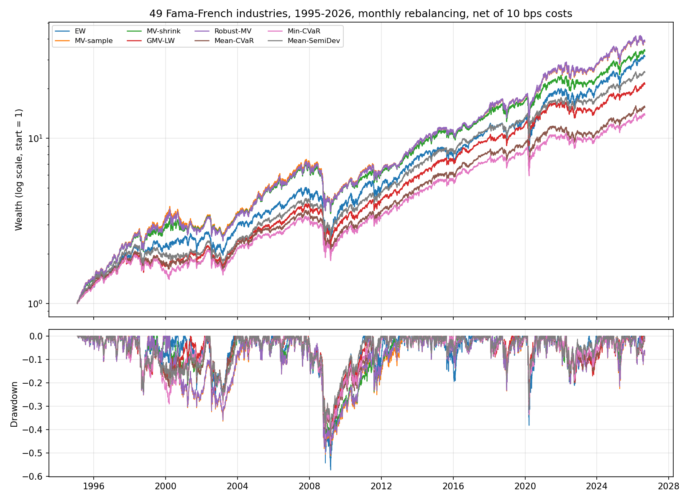
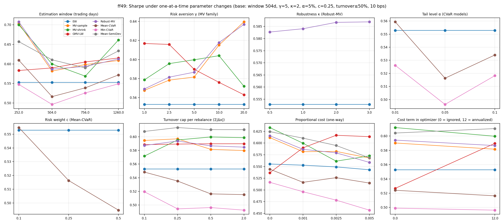
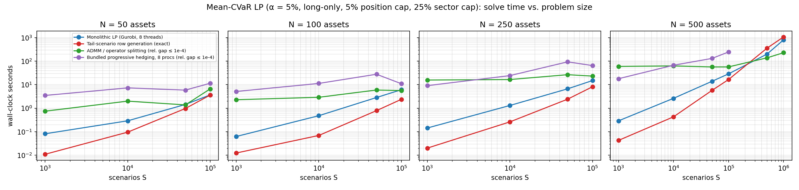

# Scalable Portfolio Optimization and Out-of-Sample Risk Evaluation

Jing Wang — October 2026

A three-layer study of portfolio construction under realistic constraints:

1. **Construction** — eight allocation rules (1/N, sample and shrinkage mean–variance, minimum variance,
   robust mean–variance, mean-CVaR, min-CVaR, mean–semideviation) under long-only, position, sector,
   turnover and transaction-cost constraints.
2. **Out-of-sample evaluation** — walk-forward backtests on two universes (31 years of survivorship-free
   industry data; the current S&P 500 cross-section), with stress periods, one-at-a-time sensitivity
   analysis, bootstrap inference on Sharpe differences, an optimizer's-curse diagnostic, and
   second-order stochastic dominance tests.
3. **Scalability** — four ways to solve the scenario-based mean-CVaR LP as the number of assets (50–500)
   and scenarios (10³–10⁶) grows: a monolithic LP, exact tail-scenario row generation, an ADMM /
   operator-splitting method with an exact CVaR prox, and bundled progressive hedging.

Everything is reproducible (section 7); code is in `src/portlib`, experiments in `experiments/`,
outputs in `results/`. Theory follows Ruszczyński's *Optimization Models in Finance* (mean–risk models,
AVaR/CVaR and its dual representation, semideviation, stochastic dominance); references are in
`references.md`.

---

## 1. Problem setup

### 1.1 Data

| Universe | Source | Assets | Period | Why |
|---|---|---|---|---|
| **FF49** | Kenneth French 49 value-weighted industry portfolios, daily | 49 | est. from 1990, OOS **1995-01 → 2026-08** (31.6 y) | survivorship-free; covers the dot-com bust, the GFC, COVID, 2022 and 2025 |
| **SP500** | Yahoo adjusted closes, current S&P 500 constituents, GICS sectors | 354 → 497 (assets with a complete 2-year history at each rebalance) | est. from 1999, OOS **2003-01 → 2026-09** | realistic cross-section for position/sector constraints and for the scalability tests |

Risk-free rate: Fama-French daily RF. The SP500 universe is **survivorship-biased** (only firms in the
index today): levels are inflated for every rule, and most for rules that chase estimated means. It is
used for *relative* comparisons and for problem sizes; FF49 is the universe for performance claims.

### 1.2 Constraint set (identical for every optimized rule)

```
sum(x) = 1,  0 ≤ x_i ≤ w_max            long-only, position cap   (FF49: 10 %, SP500: 5 %)
G x ≤ s_max                              sector cap                (FF49: 30 %, SP500: 25 %)
||x − x_prev||_1 ≤ 0.5                   turnover cap per monthly rebalance
objective − 12 · c · ||x − x_prev||_1    proportional one-way cost c = 10 bps, amortized to annual units
```
`x_prev` is the *drifted* holding carried from the previous month, so turnover and costs are the ones a
real account would see. Costs are deducted from realized returns in the backtest regardless of whether the
optimizer knows about them (`tc_scale = 0` switches off the cost term inside the optimizer only).

### 1.3 Allocation rules

| Rule | Objective (annualized moments unless noted) | Estimator |
|---|---|---|
| EW | 1/N | — |
| MV-sample | max μ'x − (γ/2) x'Σx, γ = 5 | sample μ, Σ |
| MV-shrink | same | Ledoit–Wolf (2004) constant-correlation Σ; Jorion Bayes–Stein μ |
| GMV-LW | min (γ/2) x'Σx (μ ≡ 0; γ keeps the cost term commensurable) | Ledoit–Wolf Σ |
| Robust-MV | max μ'x − κ‖Σ_μ^{1/2}x‖ − (γ/2) x'Σx, Σ_μ = Σ/T, κ = 2 (SOCP) | sample |
| Mean-CVaR | min −(1−c) E[Z] + c·AVaR_α(Z), Z = daily portfolio return, α = 5 %, c = 0.25 (LP, Rockafellar–Uryasev) | 504 daily scenarios |
| Min-CVaR | same with c = 1 | 504 daily scenarios |
| Mean-SemiDev | min −E[Z] + c·E[(E[Z] − Z)⁺], c = 0.75 (LP, Ogryczak–Ruszczyński; SSD-consistent for c ≤ 1) | 504 daily scenarios |

Estimation window 504 trading days, monthly rebalancing at month-end, buy-and-hold drift within the month.
All problems are solved with Gurobi 13 (QP / SOCP / LP).

---

## 2. Out-of-sample results — FF49, 1995–2026, net of costs

### 2.1 Headline table (`results/tables/ff49_base_summary.csv`)

| | CAGR | Ann. vol | Sharpe | Sortino | CVaR 5 % (daily) | Max DD | Calmar | Turnover / yr | Cost drag / yr |
|---|---|---|---|---|---|---|---|---|---|
| EW | 11.5 % | 18.5 % | 0.553 | 0.77 | 2.77 % | −57.4 % | 0.22 | 0.46 | 0.05 % |
| MV-sample | 12.3 % | 18.8 % | 0.582 | 0.81 | 2.84 % | −51.2 % | 0.26 | 2.68 | 0.27 % |
| MV-shrink | 11.8 % | 17.0 % | 0.600 | 0.83 | 2.58 % | −50.5 % | 0.25 | 1.68 | 0.17 % |
| GMV-LW | 10.2 % | 14.0 % | 0.590 | 0.82 | 2.09 % | −46.1 % | 0.23 | 0.34 | 0.03 % |
| Robust-MV | 12.3 % | 18.6 % | 0.587 | 0.81 | 2.82 % | −50.5 % | 0.26 | 2.67 | 0.27 % |
| Mean-CVaR | 9.1 % | 14.1 % | 0.516 | 0.72 | 2.10 % | −46.9 % | 0.21 | 2.08 | 0.21 % |
| Min-CVaR | 8.7 % | 13.9 % | 0.496 | 0.69 | 2.07 % | −46.2 % | 0.20 | 2.16 | 0.22 % |
| Mean-SemiDev | 10.8 % | 14.5 % | 0.611 | 0.85 | 2.18 % | −42.9 % | 0.26 | 1.80 | 0.18 % |



### 2.2 Is anything better than 1/N? Bootstrap inference (`ff49_base_sharpe_tests.csv`)

Stationary-bootstrap (Politis–Romano, mean block 20 days, 2,000 draws) test of the Sharpe difference on
the *paired* daily series:

| vs. EW | ΔSharpe | s.e. | p |   | vs. GMV-LW | ΔSharpe | s.e. | p |
|---|---|---|---|---|---|---|---|---|
| MV-sample | +0.03 | 0.085 | 0.74 | | MV-sample | −0.01 | 0.107 | 0.94 |
| MV-shrink | +0.05 | 0.078 | 0.56 | | MV-shrink | +0.01 | 0.087 | 0.92 |
| GMV-LW | +0.04 | 0.075 | 0.62 | | Robust-MV | −0.00 | 0.105 | 0.98 |
| Robust-MV | +0.03 | 0.085 | 0.70 | | Mean-CVaR | −0.07 | 0.041 | 0.08 |
| Mean-CVaR | −0.04 | 0.078 | 0.64 | | **Min-CVaR** | **−0.09** | 0.038 | **0.01** |
| Min-CVaR | −0.06 | 0.081 | 0.47 | | Mean-SemiDev | +0.02 | 0.051 | 0.71 |
| Mean-SemiDev | +0.06 | 0.075 | 0.44 | | | | | |

**No rule beats 1/N at any conventional significance level over 31 years** — the DeMiguel–Garlappi–Uppal
(2009) result survives position, sector and turnover constraints and 10 bps costs. The one significant
difference is *negative*: Min-CVaR has a lower Sharpe than GMV-LW (p = 0.014) while delivering the same
realized tail risk (daily CVaR 2.07 % vs 2.09 %, max drawdown −46 % for both). With 504 daily scenarios
only ~25 observations define the 5 % tail; the min-CVaR portfolio is a noisy estimate of a portfolio that
the shrunk covariance already identifies.

**Second-order stochastic dominance** (`ff49_base_ssd.csv`, monthly returns): the only ordered pair is
**GMV-LW ≻_SSD Min-CVaR** — every risk-averse expected-utility investor prefers GMV-LW's OOS return
distribution. All other pairs are SSD-incomparable (the SSD partial order is strict; incomparability is
the expected outcome).

### 2.3 What the risk models do buy: tails and crises (`ff49_base_stress.csv`)

| Period | EW | MV-sample | MV-shrink | GMV-LW | Robust-MV | Mean-CVaR | Min-CVaR | Mean-SemiDev |
|---|---|---|---|---|---|---|---|---|
| Dot-com bust 2000-03 → 2002-10, total return | −17.0 % | −31.3 % | −19.8 % | **−1.6 %** | −30.7 % | −2.9 % | +10.0 % | −6.0 % |
| GFC 2007-10 → 2009-03, total return | −56.9 % | −50.0 % | −49.3 % | −45.3 % | −49.2 % | −46.6 % | −45.9 % | **−42.4 %** |
| COVID crash 2020-02-19 → 03-23 | −38.0 % | −33.4 % | −33.2 % | **−29.8 %** | −33.1 % | −33.0 % | −33.2 % | −31.2 % |
| 2022 rate shock 01 → 10, total return | −19.4 % | −11.2 % | −14.4 % | −19.8 % | −11.0 % | −18.5 % | −17.0 % | −14.1 % |
| 2025 tariff shock 02-19 → 04-08 | −16.5 % | −19.8 % | −16.0 % | **−7.3 %** | −19.1 % | −9.2 % | −9.1 % | −11.2 % |
| Daily CVaR 5 % in GFC | 6.1 % | 5.4 % | 5.0 % | 4.5 % | 5.3 % | 4.5 % | 4.5 % | 4.6 % |

Risk-based rules (GMV-LW, CVaR, semideviation) cut the daily 5 % CVaR by a quarter and the maximum
drawdown by 11–15 points relative to 1/N, and they protected in three of five crises. The exception is
2022: a rate shock hit the low-volatility sectors (utilities, staples, health care) that minimum-risk
portfolios overweight, and GMV-LW lost as much as 1/N. Mean-based rules (MV-sample, Robust-MV) were the
worst in the dot-com bust — they chased 1998–99 technology means — and the best in 2022.

### 2.4 Sensitivity (`results/tables/sensitivity_ff49.csv`, figures `ff49_sens_*.png`)

One parameter at a time around the base configuration:



* **Estimation window.** Mean-based rules are not monotone in the window: a 1-year window gives the
  highest Sharpe for MV-sample/MV-shrink/Robust-MV (0.70–0.71, a momentum-like effect of 12-month means)
  at the cost of 4× annual turnover; a 5-year window gives 0.61–0.66 with 0.7–1.2× turnover. GMV-LW's
  Sharpe moves only between 0.58 and 0.62. The tail metrics of the CVaR rules barely move with the window.
* **Risk aversion γ.** MV-sample improves steadily as γ rises (0.57 → 0.64 at γ = 20): shrinking toward
  the minimum-variance portfolio is what helps, consistent with Jagannathan–Ma (2003).
* **Robustness κ.** Robust-MV is almost invariant to κ (0.583–0.587) and indistinguishable from MV-sample
  throughout. With the ellipsoid Σ_μ = Σ/T the worst-case term equals κ·σ_p/√T, i.e. an extra
  *standard-deviation* penalty on top of the variance penalty — it reshapes the frontier only marginally.
  Robustness to the mean has to come from the shape of the uncertainty set (box, factor-based, or
  Wasserstein), not from the radius.
* **Transaction costs: modelling them is worth more than the costs themselves.** For GMV-LW, switching
  the cost term *on* in the optimizer (everything else equal, costs charged in both cases) cuts annual
  turnover from 1.38 to 0.34 and raises net Sharpe from 0.527 to 0.590 and CAGR from 9.1 % to 10.2 %.
  Raising the assumed cost from 0 to 25 bps raises GMV-LW's net Sharpe further (0.537 → 0.617) while
  it lowers everyone else's: the cost term is acting as a regularizer of the weight path, the mechanism
  formalized by Olivares-Nadal & DeMiguel (2018).
* **Turnover caps** between 10 % and 200 % per month change Sharpe by < 0.03 once costs are in the
  objective — the cost term already does the work.
* **CVaR level α and weight c.** α ∈ {1 %, 5 %, 10 %} and c ∈ {0.1, 0.25, 0.5} move Sharpe
  non-monotonically within ±0.04 — the tail estimate is dominated by sampling noise.

### 2.5 Optimizer's curse diagnostic (`ff49_base_exante_vs_realized.csv`)

Ex-ante volatility predicted by the sample covariance at each rebalance vs. the volatility realized in
the following month:

| | EW | MV-sample | MV-shrink | GMV-LW | Robust-MV | Mean-CVaR | Min-CVaR | Mean-SemiDev |
|---|---|---|---|---|---|---|---|---|
| ex-ante σ (ann.) | 17.2 % | 17.0 % | 15.2 % | 12.6 % | 16.8 % | 12.8 % | 12.6 % | 13.2 % |
| realized σ, mean of monthly | 15.8 % | 16.5 % | 14.9 % | 12.0 % | 16.4 % | 12.0 % | 11.9 % | 12.5 % |
| realized / ex-ante | 0.92 | 0.97 | 0.98 | 0.95 | 0.98 | 0.94 | 0.94 | 0.95 |

With long-only and position caps, no rule systematically under-estimates its own risk (the classical
in-sample optimism of unconstrained MV is absent), another manifestation of constraints as shrinkage.

---

## 3. Out-of-sample results — current S&P 500 constituents, 2003–2026

`results/tables/sp500_base_summary.csv`, `sp500_base_*.png`. Read with the survivorship caveat.

| | CAGR | Ann. vol | Sharpe | CVaR 5 % | Max DD | Turnover / yr |
|---|---|---|---|---|---|---|
| EW | 17.2 % | 19.6 % | 0.824 | 2.95 % | −52.4 % | 0.70 |
| MV-sample | 26.2 % | 24.6 % | 1.004 | 3.72 % | −62.1 % | 4.27 |
| MV-shrink | 21.4 % | 20.3 % | 0.974 | 3.07 % | −55.9 % | 3.21 |
| GMV-LW | 13.2 % | 12.7 % | 0.908 | 1.83 % | −34.9 % | 0.46 |
| Robust-MV | 26.1 % | 24.3 % | 1.010 | 3.68 % | −61.4 % | 4.28 |
| Mean-CVaR | 14.5 % | 13.3 % | 0.959 | 1.94 % | −39.5 % | 3.97 |
| Min-CVaR | 13.1 % | 12.6 % | 0.910 | 1.82 % | −35.9 % | 3.69 |
| Mean-SemiDev | 17.8 % | 15.4 % | 1.036 | 2.29 % | −43.1 % | 4.00 |

* The 26 % CAGR of the mean-chasing rules is the survivorship bias made visible: conditioning on
  today's membership guarantees that the firms with the best realized 2-year means kept winning. Rules
  that ignore means (GMV-LW, Min-CVaR) are far less exposed and their numbers are closer to what the
  FF49 universe shows.
* Bootstrap Sharpe tests are again all insignificant vs. 1/N (p ≥ 0.07) and vs. GMV-LW.
* Even here, GMV-LW halves the daily CVaR and cuts the maximum drawdown by 17 points relative to 1/N
  with the lowest turnover of any optimized rule (0.46 / yr).
* Optimizer's-curse diagnostic (`sp500_base_exante_vs_realized.csv`): realized / ex-ante volatility is
  0.97–1.03 for every optimized rule — again no systematic under-estimation under the constraints.

### 3.1 Sensitivity on the S&P 500 universe (`sensitivity_sp500.csv`, `sp500_sens_*.png`)

| Change from base | Effect |
|---|---|
| Estimation window 252 → 1260 days | Sharpe falls monotonically for *every* rule (MV-sample 1.09 → 0.88, Mean-SemiDev 1.15 → 0.89, even 1/N 0.83 → 0.74 because the eligible universe shrinks); short windows carry a 12-month momentum signal in individual stocks that industry portfolios dilute. GMV-LW is the least sensitive (0.82–0.92). |
| Cost term in optimizer off → on | GMV-LW turnover 2.45 → 0.46 per year (5×), Sharpe 0.874 → 0.908, max drawdown −36.2 % → −34.9 %. For mean-based rules the term lowers turnover 5.1 → 4.3 with no Sharpe change — they keep trading on means. |
| Cost 0 → 50 bps | Sharpe drag of 0.06–0.13 for mean- and CVaR-based rules (turnover 3.7–5.1 / yr) vs 0.05 for GMV-LW. |
| Turnover cap 50 % → 10 % per month | MV-sample / Robust-MV lose 0.24 Sharpe (they can no longer follow the means); CVaR rules unchanged. |
| γ 1 → 20 | MV-shrink max drawdown −64 % → −41 %, daily CVaR 4.0 % → 2.1 %: risk aversion is the only lever that tames the survivorship-inflated mean estimates. |
| α 1 % / 5 % / 10 % | Mean-CVaR 0.89 / 0.96 / 0.99; Min-CVaR 0.90 / 0.91 / 0.87 — within noise. |

---

## 4. Scalability of the mean-CVaR LP

### 4.1 Problem and methods (`src/portlib/scale.py`)

Scenario LP with `N + S + 1` variables and `S` dense tail rows:

```
min  −(1−c) μ'x + c [ t + (1/(αS)) Σ_s u_s ]
s.t. u_s ≥ −r_s'x − t,  u_s ≥ 0,  x ∈ X        (α = 5 %, c = 0.25, long-only, 5 % cap, 25 % sector cap)
```

| Method | Idea | Exact? |
|---|---|---|
| **Monolithic** | full LP in Gurobi, 8 threads, concurrent simplex/barrier | yes |
| **Row generation** | only scenarios in a working set W carry a tail row; after each solve, scenarios with loss > t are added (dual-simplex warm start). Terminates when no row is violated → the relaxed solution is optimal for the full LP. Exploits the sparse active set: at the optimum only ≈ αS scenarios have u_s > 0. | yes |
| **ADMM / operator splitting** | split y = −Rx; x-step is an N-dimensional QP, y-step is the prox of c·CVaR_α — computed exactly via a projection onto the capped simplex Q = {0 ≤ q ≤ 1/(αS), 1'q = 1} that *is* the CVaR ambiguity set (dual representation). Never forms the LP; residual balancing for ρ. Same structure as the CVQP solver of Luxenberg et al. (2025). | to tolerance (rel. gap 10⁻⁴) |
| **Bundled progressive hedging** | 8 scenario bundles, first-stage (x, t) duplicated per bundle, consensus via augmented-Lagrangian multipliers (Rockafellar–Wets 1991); persistent Gurobi models in 8 worker processes. | to tolerance |

Scenarios: circular block bootstrap (5-day blocks) of two years of daily S&P 500 constituent returns;
N is a random subset of constituents. All four methods agree to 10⁻¹⁵ (row generation) / 10⁻⁴
(ADMM, PH) in relative objective on the 49-asset test instance (`experiments/test_solvers.py`).

### 4.2 Results (`results/tables/scale.csv`, `scale_summary.csv`, `scale_time.png`)

Hardware: Linux server, 40 cores pinned (`taskset`), Gurobi 8 threads for the monolithic LP and the
row-generation master, 8 worker processes for PH, 8 BLAS threads for ADMM. Wall-clock seconds:

| N | S | Monolithic LP | Row generation (exact) | ADMM (gap ≤ 1e-4) | PH, 8 bundles (gap ≤ 1e-4) | rows kept by row gen. | row-gen iterations |
|---|---|---|---|---|---|---|---|
| 50 | 1 000 | 0.08 | **0.01** | 0.7 | 3.5 | 18 % | 3 |
| 50 | 100 000 | 3.7 | 3.6 | 6.6 | 11.5 | 25 % | 2 |
| 100 | 10 000 | 0.48 | **0.07** | 2.9 | 11.3 | 16 % | 3 |
| 100 | 100 000 | 6.1 | **2.4** | 5.6 | 11.0 | 16 % | 2 |
| 250 | 10 000 | 1.3 | **0.26** | 16.5 | 24.3 | 39 % | 2 |
| 250 | 100 000 | 15.0 | **8.1** | 23.1 | 64.8 | 27 % | 3 |
| 500 | 1 000 | 0.29 | **0.04** | 59.7 | 17.9 | 26 % | 4 |
| 500 | 10 000 | 2.6 | **0.43** | 62.7 | 66.9 | 28 % | 3 |
| 500 | 50 000 | 13.9 | **5.7** | 56.7 | 130.6 | 32 % | 4 |
| 500 | 100 000 | 29.2 | **16.5** | 56.9 | 245.7 | 31 % | 3 |



What the numbers say:

1. **The active set is sparse and row generation exploits it exactly.** At the optimum only 0.5–0.6·αS
   scenarios have u_s > 0 (e.g. 2,387 of 100,000 at N = 500). Seeded with the 2αS worst scenarios of the
   1/N portfolio, row generation converges in 2–4 rounds while keeping 16–39 % of the scenario rows, and
   returns the *same* optimum as the full LP (relative difference ≤ 1e-9). It is 5–7× faster than the
   monolithic LP up to 10⁴ scenarios and 1.8–2.5× faster at 10⁵ with N ≥ 100; at N = 50, S = 10⁵ the
   two tie because the master itself is already large relative to the work it saves.
2. **ADMM's cost is almost independent of S** — at N = 500 it takes 57–63 s whether S = 10³ or 10⁵ —
   because each iteration is one S × N matrix–vector product plus an N-dimensional QP, and the number of
   iterations (300–650) is set by the conditioning of RᵀR, not by S. It is slower than the LP everywhere
   in this grid; the crossover for N = 500 lies between 10⁵ and 5 × 10⁵ scenarios (section 4.3). ADMM
   also never forms the LP, so its working data is just the scenario matrix (0.4 GB at 500 × 10⁵).
3. **Progressive hedging is the wrong decomposition for this problem.** The second stage of the CVaR LP
   is trivial (u_s = (ℓ_s − t)⁺ in closed form), so bundling scenarios gives each worker an LP with
   S/8 dense rows and nothing to gain from locality; consensus on (x, t) needs 16–300 iterations and each
   iteration re-solves eight QPs. PH is 2–40× slower than the monolithic LP on every cell. The scenario
   decomposition that *does* pay off here is the dual one — the capped-simplex projection inside ADMM —
   not primal scenario splitting.
4. **Conclusion:** up to ~10⁵ scenarios, a commercial simplex with an exact active-set reduction is the
   fastest route to the CVaR portfolio; beyond that the operator-splitting method takes over (4.3).

### 4.3 Beyond the grid: 5 × 10⁵ and 10⁶ scenarios at N = 500 (`scale_large.csv`)

| S | Monolithic LP | Row generation (exact) | ADMM (rel. gap ≤ 1e-4) | ADMM vs LP | LP simplex iterations | rows kept by row gen. |
|---|---|---|---|---|---|---|
| 10⁵ | 28.8 s | **16.5 s** | 56.9 s | 0.5× | 6,497 | 31 % |
| 5 × 10⁵ | 199.6 s | 356.7 s | **138.3 s** | 1.4× faster | 17,588 | 31 % |
| 10⁶ | 806.0 s | 1,072.7 s | **228.3 s** | **3.5× faster** | 20,555 | 34 % |

(PH was not run at these sizes: it was already 8× slower than the LP at 10⁵.)

5. **The ranking reverses between 10⁵ and 5 × 10⁵ scenarios.** From 10⁵ to 10⁶ the monolithic LP's
   time grows as S^1.45 (28 s → 806 s; simplex iterations triple and each iteration touches a
   497-million-nonzero matrix), while ADMM grows as S^0.6 (57 s → 228 s; the iteration count only goes
   from 300 to 412, and each iteration is a matrix–vector product linear in S). At 10⁶ scenarios ADMM
   reaches a 10⁻⁴ relative gap 3.5× faster than Gurobi reaches the exact optimum.
6. **Row generation stops paying off at large S.** The active set stays at ≈ 0.5·αS (28,140 scenarios at
   10⁶), but seeding from the 1/N portfolio and adding every violated row leaves 31–34 % of the rows in
   the master — 340,000 dense rows at 10⁶ — so the master LP is itself large and the method falls behind
   the full LP. Seeding instead from a cheap 2,000-scenario solve (`scale_rowgen_sub.csv`) cut the time
   at N = 500, S = 10⁵ from 16.5 s to 10.0 s (and at N = 250 from 8.1 s to 4.9 s) but kept *more* rows at
   S = 5 × 10⁴; a selective rule for adding rows (only the most violated, as in Espinoza & Moreno 2014's
   aggregation) is the natural next step.
7. **Exactness vs. speed.** The comparison at large S is not like-for-like: ADMM stops at a relative
   objective gap of 10⁻⁴ (portfolio weights within ≈ 1.5 % in ℓ₁ of the LP optimum on the test instance),
   the LP and row generation are exact. For a monthly rebalance a 10⁻⁴ gap is far below the estimation
   error of the scenarios themselves, so the approximate method is the right tool there.

Overall: exact active-set reduction wins below ~10⁵ scenarios; dual-side operator splitting (the CVaR
prox as a projection onto the capped-simplex ambiguity set) wins above ~3 × 10⁵ and is the only method
whose cost grows sub-linearly in S; primal scenario decomposition (PH) never wins on this structure
because the second stage is closed-form.

---

## 5. Summary

Under realistic constraints, 31 years of survivorship-free data do not let any of eight construction
rules beat 1/N on Sharpe at conventional significance; what the risk-based rules reliably deliver is a
25 % lower realized tail (daily CVaR), 11–15 points less maximum drawdown and protection in most — not
all — crises. The single most valuable modelling decision in the study was not the choice of risk
measure but putting the transaction-cost term inside the optimizer, which raised the minimum-variance
rule's net Sharpe from 0.53 to 0.59 by cutting turnover 4×. Mean-CVaR estimated on two years of daily
scenarios is second-order stochastically dominated by shrinkage minimum variance: tail estimation
error, not the risk measure, is the binding constraint. On the computational side the CVaR LP has a
sparse active set (≈ 0.5·αS scenarios), which exact row generation exploits to run 2–7× faster than the
full LP up to 10⁵ scenarios; above ~3 × 10⁵ scenarios an ADMM method built on the CVaR dual
representation takes over (3.5× faster at 10⁶, runtime growing as S^0.6 vs S^1.45), while primal
scenario decomposition (progressive hedging) is never competitive on this structure.

## 6. Scope and design choices

* **Universes.** FF49 industry portfolios give a survivorship-free 31-year sample and are the basis for
  all performance claims. The S&P 500 universe uses current index membership, so its absolute levels
  are inflated (most for mean-driven rules); it is used for cross-strategy comparisons, realistic
  position/sector constraints and problem sizes. A point-in-time (CRSP) universe is the natural extension.
* **Costs.** Proportional one-way cost of 10 bps in the base case, swept from 0 to 50 bps.
* **Hyper-parameters.** The base configuration was fixed *a priori* and evaluated by one-at-a-time
  sensitivity rather than tuned on the backtest, which avoids selection bias across configurations
  (cf. Bailey & López de Prado's deflated Sharpe ratio).
* **Inference.** Stationary-bootstrap tests assume stationarity over the full sample; crisis
  sub-periods are therefore reported separately.
* **Extensions.** Wasserstein-ball uncertainty sets for the robust and CVaR models; selective row
  addition / scenario aggregation for the row-generation method at S ≥ 5 × 10⁵.

## 7. Reproducing the results

Requirements: Python ≥ 3.10, `pip install -r requirements.txt`, and a Gurobi license (an academic
license is sufficient). Data are not redistributed; the scripts download them:

```bash
python src/download_ff.py        # Kenneth French data library: 49 industries + factors
python src/prepare_ff.py
python src/download_sp500.py     # S&P 500 constituents (Wikipedia) + adjusted prices (Yahoo Finance)
./reproduce.sh                   # backtests, analysis, sensitivity, scalability, figures
```

The scalability grid up to 10⁵ scenarios takes about one hour on 40 cores; the 5 × 10⁵ and 10⁶
instances need roughly 64 GB of memory for the monolithic LP.

## 8. Repository layout

```
src/portlib/      data.py estimators.py models.py backtest.py metrics.py scale.py
src/              download_ff.py prepare_ff.py download_sp500.py
experiments/      config.py run_backtests.py analyze_run.py run_sensitivity.py plot_sensitivity.py
                  run_scale.py plot_scale.py test_solvers.py
results/          tables/ figures/
references.md
```
